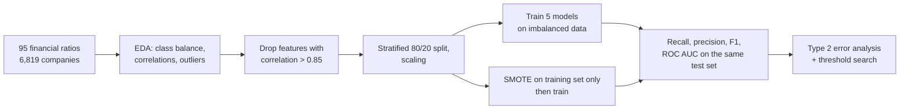

# Bankruptcy Prediction: When 97% Accuracy Means Missing Most Bankruptcies

**Predicting company bankruptcy from 95 financial ratios, where only 3.2% of companies go bankrupt. Six models, imbalanced vs. SMOTE-balanced training, and a threshold optimizer that broke in an instructive way.**

[](https://colab.research.google.com/github/dojedaro/bankruptcy-prediction-imbalanced-classification/blob/main/bankruptcy_prediction.ipynb)
[](https://github.com/dojedaro/bankruptcy-prediction-imbalanced-classification/actions/workflows/notebooks.yml)

## Results

Data: 6,819 Taiwanese companies (the UCI *Taiwanese Bankruptcy Prediction* dataset), 220 bankrupt.
Stratified 80/20 split; the test set has 1,364 companies, 44 of them bankrupt.

**Trained on the imbalanced data, every model looks excellent and is nearly useless:**

| Model | Accuracy | Recall (bankrupt) | Precision | F1 | ROC AUC |
|---|---|---|---|---|---|
| Logistic regression | 0.972 | 0.20 | 0.75 | 0.32 | 0.934 |
| Random forest | 0.966 | 0.16 | 0.44 | 0.23 | 0.911 |
| Gradient boosting | 0.965 | 0.27 | 0.43 | 0.33 | 0.939 |
| XGBoost | 0.971 | 0.34 | 0.60 | 0.43 | 0.921 |
| Neural network (MLP) | 0.968 | 0.09 | 0.50 | 0.15 | 0.840 |

A model that never predicts bankruptcy scores 96.8% accuracy here. The logistic regression catches
**9 of 44** bankruptcies.

**With SMOTE oversampling on the training set**, recall jumps and precision drops, which is the trade
a lender actually wants:

| Model | Recall | Precision | F1 |
|---|---|---|---|
| Logistic regression | **0.84** | 0.20 | 0.32 |
| Gradient boosting | 0.75 | 0.28 | 0.40 |
| Random forest | 0.64 | 0.39 | **0.49** |
| XGBoost | 0.64 | 0.39 | **0.49** |
| Neural network (MLP) | 0.48 | 0.36 | 0.41 |

### The threshold optimizer that went the wrong way

The last section tries to tune the decision threshold to minimize missed bankruptcies, weighting a miss
at 20 false alarms. On the logistic regression it chose a threshold of **0.91**, which *raised* the
missed-bankruptcy rate to 82% (36 of 44), and a later pass chose **0.01**, which flags every company
(accuracy 3.2%, zero misses). Both are what you get when the search optimizes the wrong objective or
direction. The fix is to pick the threshold on a validation split from the precision-recall curve
under an explicit cost, and never on the test set.

## How it works



SMOTE is applied to the training data only, so the test set keeps the real 3.2% bankruptcy rate.

## Run it

Download the dataset (Kaggle "Company Bankruptcy Prediction", from the UCI Taiwanese bankruptcy data)
as `Dataset.csv` next to the notebook.

```bash
pip install -r requirements.txt
jupyter notebook bankruptcy_prediction.ipynb
```

## Stack

Python, pandas, scikit-learn, imbalanced-learn (SMOTE and variants), XGBoost, TensorFlow/Keras,
Matplotlib, seaborn.

## Limitations and next steps

- One split and one seed; with 44 bankrupt companies in the test set, every recall above moves by
  2.3 points per company. Repeated stratified cross-validation would give intervals.
- Compare SMOTE with class weights and with threshold tuning on a validation split, which often matches
  oversampling without synthetic data.
- Report precision at a fixed recall (for example 80%), the number a credit team would set.

*Extracted on 2026-11-13 from a catch-all coursework repository into its own project.*

## License

MIT
